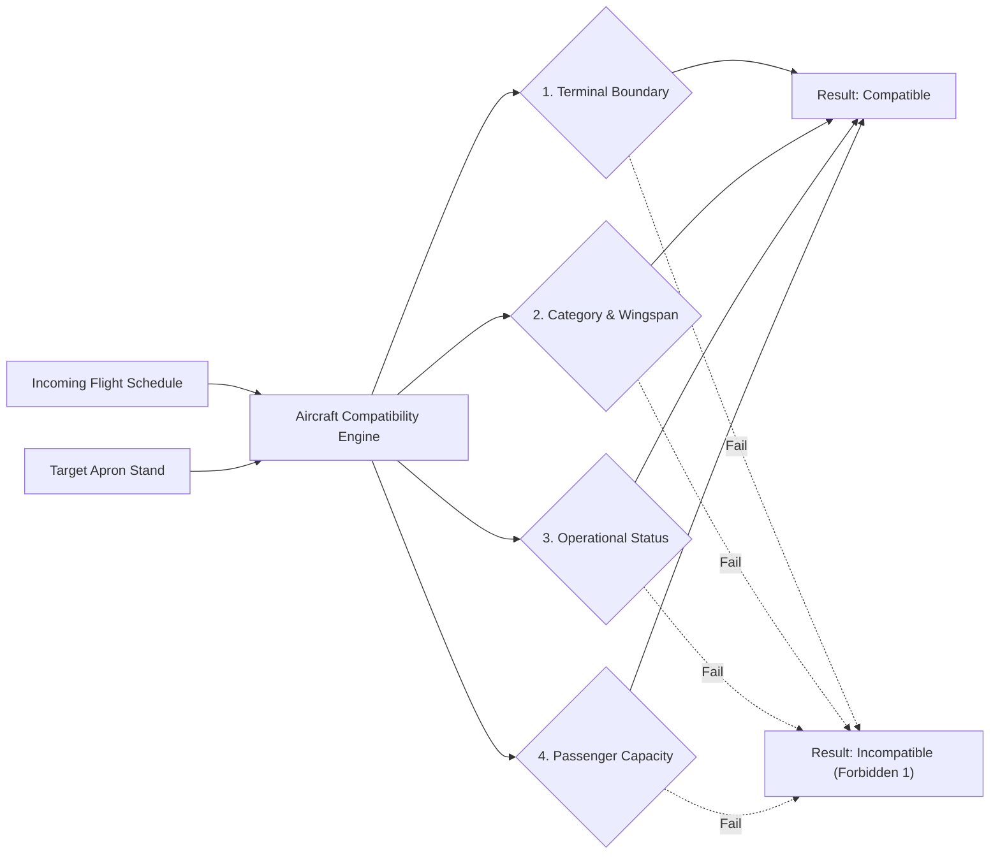

# GateWise BLR — Aircraft Compatibility Engine
## Multi-Dimensional Verification Rules & Restriction Mapping

### 1. Compatibility Dimensions
The Aircraft Compatibility Engine evaluates flight-to-stand assignments across four distinct operational dimensions before an assignment can be accepted:

---

### 2. Rule Formulations

#### Dimension 1: Terminal Eligibility Boundary
- **Rule**: `Flight.terminal == Gate.terminal`
- **Policy**:
  - Flights assigned to Terminal 1 must dock at Terminal 1 stands.
  - If `Flight.flight_type == "International"` and `Gate.terminal == "T1"`, the assignment is strictly forbidden:
    $$\text{ForbiddenReason} = \text{"Terminal 1 exclusively handles domestic flights. International operations must use Terminal 2."}$$

#### Dimension 2: Aircraft Category Rank & Wingspan Limits
- **ICAO Category Rank Hierarchy**:
  $$\text{Rank}(\text{Code C}) = 1 < \text{Rank}(\text{Code D}) = 2 < \text{Rank}(\text{Code E}) = 3 < \text{Rank}(\text{Code F}) = 4$$
- **Rule**:
  $$\text{Rank}(\text{Flight.aircraft\_category}) \le \text{Rank}(\text{Gate.aircraft\_category})$$
- **Physical Envelope**:
  $$\text{Flight.wingspan\_m} \le \text{Gate.max\_wingspan\_m}$$
- **Example Rejection**:
  - Flight FL-001 (Air India B777, Code E, wingspan ~64.8m) assigned to Gate GT-001 (Stand 1, Code C, max wingspan 36.0m):
    $$\text{Diagnostic}: \text{"Aircraft Category Limit Exceeded: Flight aircraft is Code E, but Stand supports up to Code C only."}$$

#### Dimension 3: Stand Operational Status
- **Rule**: `Gate.status.lower() not in ["maintenance", "closed", "restricted"]`
- **Policy**: If an apron stand is undergoing ground maintenance or pavement repaving, all flights assigned to it are blocked.

#### Dimension 4: Passenger Capacity Threshold
- **Rule**: `Flight.passenger_capacity <= Gate.max_capacity`
- **Policy**: Passenger concourse holding lounges must accommodate the maximum seating capacity of the docking aircraft.

---

### 3. Integration with the Binary Restriction Matrix $B$
The compatibility engine directly interfaces with the discrete mathematics solver:
- When an operator initiates the Guided Allocation Workspace (Step 3), they can click **"Apply BLR Compatibility Rules"**.
- The engine evaluates every cell $(i, j) \in [n] \times [n]$:
  $$B_{i, j} = \begin{cases} 1 & \text{if any compatibility check fails (Forbidden assignment)} \\ 0 & \text{if all compatibility checks pass (Allowed assignment)} \end{cases}$$
- This generates the binary board $B$ directly from genuine airport constraints, ensuring that the resulting Rook Polynomial $R(B, x)$ and valid assignment count $N$ reflect real-world aviation physics.
