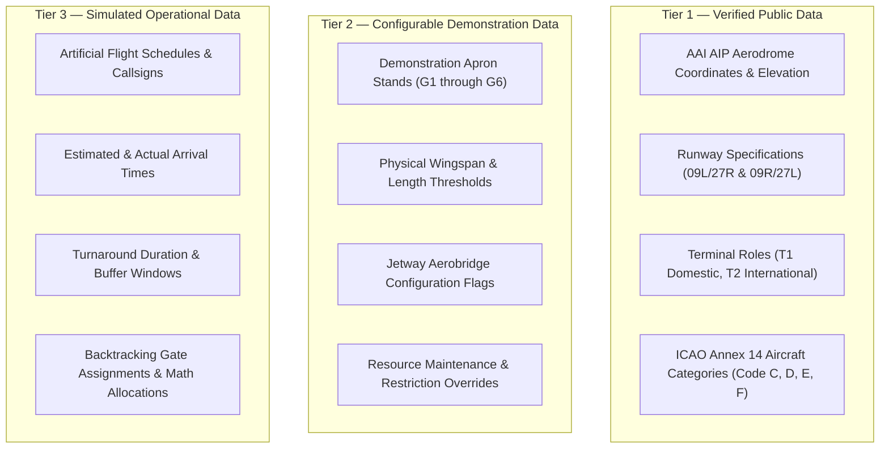

# GateWise BLR — Three-Tier Data Classification Architecture
## Data Classification, Provenance, & Disclosure Policy

### 1. The Three-Tier Architecture
To maintain academic rigor and ethical software engineering standards, GateWise BLR strictly partitions all application state, models, and UI presentations into three explicit tiers:

---

### 2. Tier Specifications

#### Tier 1: Verified Public Data (`VERIFIED_PUBLIC_DATA`)
- **Definition**: Information confirmed through published aeronautical information publications, government gazettes, and official airport operator disclosures.
- **Handling Rules**:
  - Read-only within the core configuration (`backend/app/core/airport_config.py`).
  - Cannot be arbitrarily modified by simulation events.
  - Accompanied by citation metadata in the API response.
- **Examples**: Runway lengths (4,000 m), CAT III-B certification, T1 domestic carrier assignment (IndiGo, Akasa, SpiceJet), T2 international carrier assignment (Emirates, Singapore Airlines, Lufthansa).

#### Tier 2: Configurable Demonstration Data (`CONFIGURABLE_DEMONSTRATION_DATA`)
- **Definition**: Airport infrastructure records configured for academic scenarios where full proprietary internal blueprints are unavailable or outside simulation scope.
- **Handling Rules**:
  - Configurable through the administration views and scenario fixtures.
  - Explicitly labeled in the UI with an amber badge (`DEMO STAND`).
  - Clear separation between contact aerobridge stands and remote apron stands.
- **Examples**: Stands G1–G2 (T1 narrow-body), Stands G3–G5 (T2 wide-body Code E), Stand G6 (T2 dual-aerobridge Code F).

#### Tier 3: Simulated Operational Data (`SIMULATED_OPERATIONAL_DATA`)
- **Definition**: Dynamic operational records generated to evaluate mathematical algorithms, resource congestion, and schedule conflict resolution.
- **Handling Rules**:
  - Time-stamped against the simulation clock, not system wall time.
  - Accompanied by an emerald/cyan simulated indicator badge (`SIMULATED`).
  - Clearly separated from historical reality in all reports and PDF/CSV exports.
- **Examples**: Artificial flight schedule AI101 arriving at 08:30, 45-minute turnaround times, simulated 30-minute monsoon delays.

---

### 3. User Interface Labeling Standards
1. **Header Pinned Telemetry**: Shows `VOBL / BLR` and `SIMULATED OPERATIONS` badge at all times.
2. **Table Disclaimers**: Every flight and gate table includes an informational pill indicating the data tier.
3. **Export Headers**: All CSV and PDF exports carry the disclaimer: *"Academic Digital Twin Prototype — Simulated Operational Data (Not connected to BIAL internal systems)"*.
