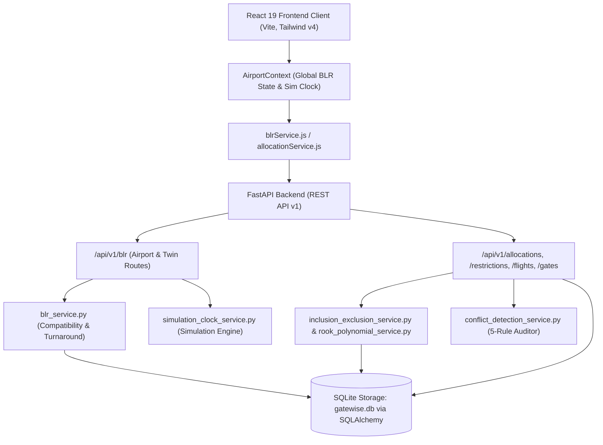

# GateWise BLR — System Architecture
## Modular Full-Stack Engineering Specification

### 1. Architectural Overview
GateWise BLR is architected as a clean, layered decision-support system separating presentation, business logic, domain simulation, and discrete mathematical verification.

---

### 2. Frontend Layer (React 19)
- **Framework**: React 19 with Vite bundler.
- **Styling**: Tailwind CSS v4 (`@tailwindcss/vite`) using a specialized aviation dark palette (Deep Navy `#07101e`, Cyan `#00f0ff`, Slate `#64748b`, Amber Warning `#f59e0b`).
- **State Management**:
  - `AirportContext.jsx`: Provides application-wide terminal selection (`selectedTerminal`: `'ALL' | 'T1' | 'T2'`), live simulated clock telemetry, airport configuration metadata, and active alert feeds.
- **Key Views**:
  - `Dashboard.jsx`: BLR Operations Center displaying live statistics, terminal comparison cards, and alert notifications.
  - `TerminalManagement.jsx`: Detailed views of Terminal 1 and Terminal 2 specifications, airline allocations, and stand tables.
  - `DigitalAirportMap.jsx`: Interactive SVG schematic of BLR aprons, runways (09L/27R & 09R/27L), and clickable stand inspection drawer.
  - `AllocationWorkspace.jsx`: 7-step guided allocation workflow featuring one-click auto-population of restrictions from BLR compatibility rules.
  - `ScenarioManagement.jsx`: Disruption simulation and combinatorial scenario evaluation.
  - `ReportsHub.jsx`: Multi-format PDF and CSV export center.

---

### 3. Backend Layer (FastAPI & Python 3.14)
- **Framework**: FastAPI with asynchronous ASGI endpoints and synchronous ORM handlers for deterministic database access.
- **ORM & Database**: SQLAlchemy 2.0 with SQLite database (`backend/data/gatewise.db`).
- **Automatic Migration**: `upgrade_schema(engine)` in `connection.py` non-destructively inspects table columns via `PRAGMA table_info` and issues `ALTER TABLE ADD COLUMN` for new digital twin fields.
- **Modularity**:
  - `app/core/airport_config.py`: Single source of truth for verified BLR aerodrome facts, runways, terminals, and aircraft categories.
  - `app/services/blr_service.py`: Multi-dimensional aircraft-stand compatibility evaluation, turnaround window occupancy calculations, and operational alert generation.
  - `app/services/simulation_clock_service.py`: In-memory state machine for operational simulation clock (tick, speed scaling, event dispatch).
  - `app/services/rook_polynomial_service.py`: Combinatorial non-attacking rook placement polynomial computation.
  - `app/services/inclusion_exclusion_service.py`: Exact integer evaluation of valid assignments $N$ using the Principle of Inclusion-Exclusion.
  - `app/services/allocation_generator_service.py`: Backtracking search generator for conflict-free flight-to-gate assignment vectors.
  - `app/services/conflict_detection_service.py`: Independent 5-rule auditor validating every assignment against double-booking, capacity, aircraft type, time-overlap, and forbidden cells.
  - `app/services/pdf_report_service.py`: ReportLab two-pass binary PDF generator creating publication-grade reports with digital twin disclaimers.
