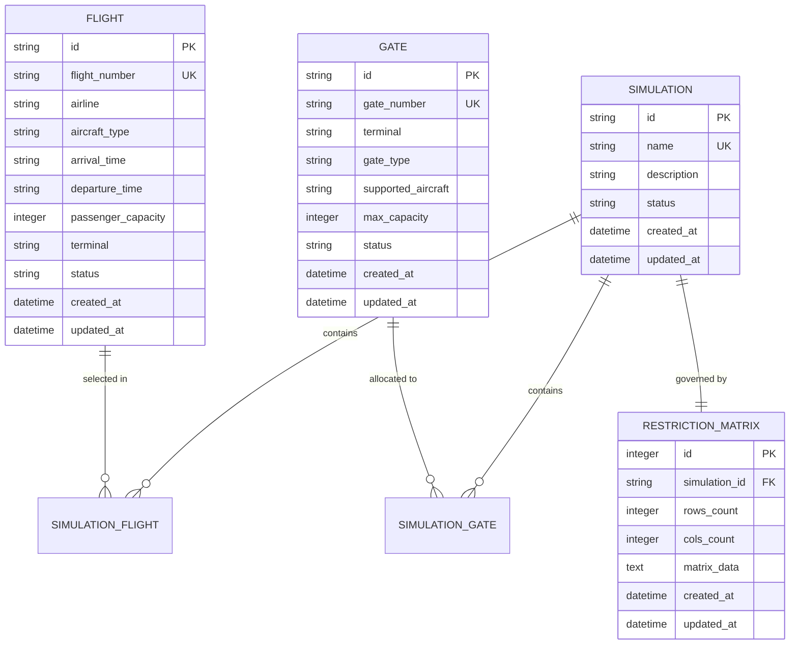

# Phase 12 — GateWise Database Integration Report

**Project**: GateWise — Intelligent Airport Gate Allocation Using Discrete Mathematics  
**Phase**: 12 — GateWise Database Integration  
**Status**: Completed & Verified  
**Date**: November 15, 2026  

---

## 1. Executive Summary

Phase 12 transitions GateWise from a browser-only client-side storage model to a persistent full-stack architecture. The existing FastAPI backend has been integrated with SQLAlchemy 2.1 and SQLite to provide persistent relational storage for all airport operational entities: **Flights**, **Gates**, **Simulations**, and **Restriction Matrices**. 

All four frontend service layers (`flightService.js`, `gateService.js`, `simulationService.js`, and `restrictionService.js`) have been connected to versioned REST API endpoints under `/api/v1` via Axios. Transparent case adapters bridge the wire format (`snake_case`) with React frontend states (`camelCase`), ensuring full backward compatibility and zero regressions in the UI. Resilient local caching ensures immediate reactivity and offline fallback.

---

## 2. Database Architecture & Schema

### 2.1 Database Engine Configuration
- **Engine**: SQLite via SQLAlchemy 2.1 ORM (`sqlite:///./data/gatewise.db`).
- **Connection Flags**: `check_same_thread: False`, automatic directory creation (`backend/data/`).
- **Session Management**: Scoped generator dependency `get_db()` with clean lifecycle commit/rollback/close semantics.

### 2.2 Relational Model Entity Details
Located in [entities.py](file:///c:/Users/rudra%20pratap/OneDrive/Documents/Intelligent%20Airport%20Gate%20Allocation/backend/app/models/entities.py):



1. **`Flight` (`flights`)**:
   - `id` (VARCHAR primary key, e.g. `FL-001`).
   - `flight_number` (VARCHAR unique indexed, e.g. `AI101`).
   - `airline`, `aircraft_type`, `arrival_time`, `departure_time`, `passenger_capacity`, `terminal`, `status`.
   - `created_at`, `updated_at`.
2. **`Gate` (`gates`)**:
   - `id` (VARCHAR primary key, e.g. `GT-001`).
   - `gate_number` (VARCHAR unique indexed, e.g. `G1`).
   - `terminal`, `gate_type`, `supported_aircraft`, `max_capacity`, `status`.
   - `created_at`, `updated_at`.
3. **`Simulation` (`simulations`)**:
   - `id` (VARCHAR primary key, e.g. `SIM-001`).
   - `name` (VARCHAR unique, e.g. `Morning Peak Allocation (6x6 Benchmark)`).
   - `description`, `status` (`Draft`, `Ready`, `Completed`).
   - `created_at`, `updated_at`.
4. **Junction Associations (`simulation_flights`, `simulation_gates`)**:
   - Foreign key associations with cascade behavior linking simulation scenarios to specific subsets of flights and gates.
5. **`RestrictionMatrix` (`restriction_matrices`)**:
   - `id` (Integer primary key), `simulation_id` (ForeignKey referencing `simulations.id`, unique).
   - `rows_count` (int), `cols_count` (int).
   - `matrix_data` (Text storing the canonical 2D binary array as JSON).
   - `created_at`, `updated_at`.

---

## 3. Database Seeding & Benchmark Scenarios

The seeder ([seed.py](file:///c:/Users/rudra%20pratap/OneDrive/Documents/Intelligent%20Airport%20Gate Allocation/backend/app/database/seed.py)) automatically executes on application startup if the database is uninitialized:
- **6 Master Flights**: `FL-001` (`AI101`), `FL-002` (`UK202`), `FL-003` (`6E303`), `FL-004` (`SG404`), `FL-005` (`AI505`), `FL-006` (`UK606`).
- **6 Master Gates**: `GT-001` (`G1`), `GT-002` (`G2`), `GT-003` (`G3`), `GT-004` (`G4`), `GT-005` (`G5`), `GT-006` (`G6`).
- **3 Benchmark Simulation Scenarios**:
  - `SIM-001`: *Morning Peak Allocation (6×6 Benchmark)* — 6 flights × 6 gates with the standard 5 forbidden cells ($b_{1,2}, b_{2,4}, b_{3,5}, b_{4,1}, b_{5,3} = 1$).
  - `SIM-002`: *Regional Shuttle Window (3×3 Sample)* — 3 flights × 3 gates with 3 forbidden cells.
  - `SIM-003`: *Evening International Hub (Draft)* — 2 flights × 2 gates.

---

## 4. REST API Endpoint Specification

All endpoints are registered under `/api/v1` via [api_v1.py](file:///c:/Users/rudra%20pratap/OneDrive/Documents/Intelligent%20Airport%20Gate%20Allocation/backend/app/routes/api_v1.py):

| Method | Route | Description | Validation / Protection |
| :--- | :--- | :--- | :--- |
| `GET` | `/api/v1/flights` | Retrieve all registered flights | Ordered by creation date descending |
| `GET` | `/api/v1/flights/{id}` | Retrieve single flight record | 404 if not found |
| `POST` | `/api/v1/flights` | Create new flight record | 409 on duplicate flight number; 422 on invalid schema |
| `PUT` | `/api/v1/flights/{id}` | Update existing flight record | 409 if renaming to existing flight number |
| `DELETE` | `/api/v1/flights/{id}` | Delete flight record | **409 Conflict** if flight is assigned to active simulations |
| `GET` | `/api/v1/gates` | Retrieve all airport gates | Ordered by gate number |
| `GET` | `/api/v1/gates/{id}` | Retrieve single gate record | 404 if not found |
| `POST` | `/api/v1/gates` | Create new gate record | 409 on duplicate gate number |
| `PUT` | `/api/v1/gates/{id}` | Update existing gate properties | 409 if renaming to existing gate number |
| `DELETE` | `/api/v1/gates/{id}` | Delete gate record | **409 Conflict** if gate is assigned to active simulations |
| `GET` | `/api/v1/simulations` | Retrieve all simulation scenarios | Includes selected flight and gate IDs |
| `GET` | `/api/v1/simulations/{id}` | Retrieve single simulation scenario | Includes selected flight and gate IDs |
| `POST` | `/api/v1/simulations` | Create simulation scenario | 409 on duplicate name; auto-initializes restriction matrix |
| `PUT` | `/api/v1/simulations/{id}` | Update simulation scenario | Re-syncs junction entities and adjusts matrix dimensions |
| `DELETE` | `/api/v1/simulations/{id}` | Delete scenario | Cascades to junction tables and restriction matrix |
| `POST` | `/api/v1/simulations/{id}/duplicate` | Duplicate scenario | Deep copies scenario and exact restriction matrix |
| `GET` | `/api/v1/simulations/{id}/restrictions` | Get binary restriction matrix | Default zero matrix if not present; alias at `/restrictions/{id}` |
| `PUT` | `/api/v1/simulations/{id}/restrictions` | Save binary restriction matrix | Validates all cells $\in \{0, 1\}$; alias at `/restrictions/{id}` |

---

## 5. Frontend Service Layer Migration

1. **API Client ([api.js](file:///c:/Users/rudra%20pratap/OneDrive/Documents/Intelligent%20Airport%20Gate%20Allocation/frontend/src/lib/api.js))**:
   - Configured Axios instance with `baseURL: '/api/v1'`, timeout 10000ms, and standard JSON headers.
   - Comprehensive response interceptor extracting clear error messages from FastAPI/Pydantic validation schemas.
2. **Service Layers**:
   - [flightService.js](file:///c:/Users/rudra%20pratap/OneDrive/Documents/Intelligent%20Airport%20Gate%20Allocation/frontend/src/lib/flightService.js): Async CRUD communicating with `/api/v1/flights`, dual-casing mapping adapter (`flight_number` $\leftrightarrow$ `flightNumber`), and local cache persistence.
   - [gateService.js](file:///c:/Users/rudra%20pratap/OneDrive/Documents/Intelligent%20Airport%20Gate%20Allocation/frontend/src/lib/gateService.js): Async CRUD communicating with `/api/v1/gates`, dual-casing adapter (`max_capacity` $\leftrightarrow$ `maxCapacity`).
   - [simulationService.js](file:///c:/Users/rudra%20pratap/OneDrive/Documents/Intelligent%20Airport%20Gate%20Allocation/frontend/src/lib/simulationService.js): Async CRUD & duplication communicating with `/api/v1/simulations` and `/api/v1/simulations/{id}/duplicate`.
   - [restrictionService.js](file:///c:/Users/rudra%20pratap/OneDrive/Documents/Intelligent%20Airport%20Gate%20Allocation/frontend/src/lib/restrictionService.js): Communicating with `/api/v1/simulations/{id}/restrictions` with instant optimistic UI cell toggles.
3. **UI Page Updates**:
   - [FlightManagement.jsx](file:///c:/Users/rudra%20pratap/OneDrive/Documents/Intelligent%20Airport%20Gate%20Allocation/frontend/src/pages/FlightManagement.jsx): Async data fetching, loading spinners, non-blocking initial rendering from local cache, server-side duplicate prevention error toasts.
   - [GateManagement.jsx](file:///c:/Users/rudra%20pratap/OneDrive/Documents/Intelligent%20Airport%20Gate%20Allocation/frontend/src/pages/GateManagement.jsx): Async CRUD operations with server-side validation.
   - [AllocationSimulator.jsx](file:///c:/Users/rudra%20pratap/OneDrive/Documents/Intelligent%20Airport%20Gate%20Allocation/frontend/src/pages/AllocationSimulator.jsx): Parallel async hydration via `Promise.all()`, backend-powered scenario duplication.
   - [RestrictionMatrix.jsx](file:///c:/Users/rudra%20pratap/OneDrive/Documents/Intelligent%20Airport%20Gate%20Allocation/frontend/src/pages/RestrictionMatrix.jsx): Async matrix retrieval and background API synchronization on toggles and bulk operations.
   - [Dashboard.jsx](file:///c:/Users/rudra%20pratap/OneDrive/Documents/Intelligent%20Airport%20Gate%20Allocation/frontend/src/pages/Dashboard.jsx): Replaced static placeholder notices with dynamic database telemetry indicators.

---

## 6. Verification & Automated Test Results

### 6.1 Backend Pytest Test Suite
All 13 automated backend tests pass cleanly:
```
backend/tests/test_architecture.py::test_openapi_docs_available PASSED           [  7%]
backend/tests/test_architecture.py::test_swagger_ui_loads PASSED                 [ 15%]
backend/tests/test_architecture.py::test_redoc_loads PASSED                      [ 23%]
backend/tests/test_architecture.py::test_api_v1_flights_placeholder PASSED       [ 30%]
backend/tests/test_architecture.py::test_api_v1_gates_placeholder PASSED         [ 38%]
backend/tests/test_architecture.py::test_api_v1_simulations_placeholder PASSED   [ 46%]
backend/tests/test_architecture.py::test_api_v1_restrictions_placeholder PASSED  [ 53%]
backend/tests/test_architecture.py::test_custom_http_error_handler PASSED        [ 61%]
backend/tests/test_database.py::test_flight_crud PASSED                          [ 69%]
backend/tests/test_database.py::test_gate_crud PASSED                            [ 76%]
backend/tests/test_database.py::test_simulation_workflow PASSED                  [ 84%]
backend/tests/test_health.py::test_health_endpoint PASSED                        [ 92%]
backend/tests/test_health.py::test_health_endpoint_fields PASSED                 [100%]

============================= 13 passed in 1.46s ==============================
```

### 6.2 Frontend Production Build
Vite production build completed with zero errors:
```
dist/index.html                   0.82 kB │ gzip:   0.44 kB
dist/assets/index-Cb_g20oa.css   55.52 kB │ gzip:   9.28 kB
dist/assets/index-BaTpCxiB.js   474.77 kB │ gzip: 138.13 kB
✓ built in 801ms
```

---

## 7. Next Steps

Phase 12 is fully implemented and verified. In accordance with the project roadmap, work on **PHASE 13 — ROOK POLYNOMIAL CALCULATION ENGINE** will commence upon receiving your explicit approval.
