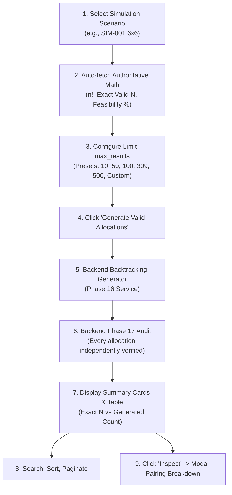

# Phase 18 Completion Report — Allocation Results UI

**Project**: GateWise — Intelligent Airport Gate Allocation Using Discrete Mathematics  
**Phase**: 18 — Allocation Results UI  
**Status**: Completed & Verified  
**Date**: November 15, 2026  

---

## 1. Executive Summary

Phase 18 establishes the complete end-to-end integration of GateWise's discrete mathematical engines into the user interface. 

The frontend now connects directly to the backend's:
1. **Rook Polynomial & PIE Engines** (Phases 13 & 14): Authoritatively calculates the exact number of conflict-free flight-to-gate assignments ($N$) and permutation totals ($n!$).
2. **Backtracking Allocation Generator** (Phase 16): Generates individual, conflict-free assignments satisfying binary restriction constraints up to a configurable safe limit (`max_results`).
3. **Independent Conflict Detection Engine** (Phase 17): Audits each generated allocation with zero trust, displaying explicit `VALID` or `INVALID` badges and detailed conflict breakdowns.

The user interface preserves all Phase 8 scenario management capabilities through a dual-mode tab structure at `/simulator`, while delivering a dedicated, dark-aviation-themed **Allocation Results Interface** with search, sorting, pagination, empty states, and modal pairing inspection.

---

## 2. Architecture & Modified/Created Components

| Component | Path | Description |
| :--- | :--- | :--- |
| **REST Router** | `backend/app/routes/allocations.py` | Added `/api/v1/simulations/{sim_id}/calculate`, `/api/v1/simulations/{sim_id}/allocations`, and `/api/v1/allocations/validate` endpoints. |
| **Router Aggregator** | `backend/app/routes/api_v1.py` | Registered `allocations.router` in the v1 API router. |
| **Pydantic Schemas** | `backend/app/schemas/api_schemas.py` | Added `AllocationValidationRequest` and enhanced `AllocationPlan` with optional `validation` result. |
| **Backend Route Tests** | `backend/tests/test_allocation_routes.py` | 5 tests verifying calculate, generate, limits, 404/422 responses, and standalone validation. |
| **Frontend API Service** | `frontend/src/lib/allocationService.js` | Client adapter for calculation, allocation generation, and independent conflict auditing. |
| **Allocation Results Component** | `frontend/src/components/allocations/AllocationResultsView.jsx` | Dedicated UI component for mathematical summary cards, generator controls, results table, and modal inspection. |
| **Simulator Page** | `frontend/src/pages/AllocationSimulator.jsx` | Unified `/simulator` route into dual tabs: **Allocation Results** and **Scenario Management**. |

---

## 3. UI Workflow & Features



### 3.1 Results Summary Metrics (Section 3)
The summary bar presents 4 authoritative cards:
- **Total Permutations ($n!$)**: Unconstrained bijective matchings (e.g., $6! = 720$).
- **Exact Valid Total ($N$)**: Discrete mathematical total from Inclusion-Exclusion (e.g., $N = 309$, $42.9\%$ feasibility).
- **Generated Allocations Count**: The actual individual assignments currently returned by the generator ($g$), with a badge indicating `Complete` vs `Limit Reached`.
- **Conflict Audit Status**: Independent verification confirmation from the Phase 17 engine (`100% Conflict-Free`).

### 3.2 Allocation Results Table (Section 4 & 5)
- **Search**: Filter allocations by allocation number (`#001`), flight ID (`FL-001`), or gate ID (`GT-001`).
- **Sorting**: Toggle between allocation number ascending/descending or validation status.
- **Pagination**: Configurable page sizes (10, 25, 50) with previous/next navigation and matching count indicators.
- **Visual Assignment Preview**: Badges displaying flight-to-gate links (`FL-001 → GT-001`).
- **Independent Validation Badges**:
  - `VALID (0 Conflicts)` in green with shield checkmark icon.
  - `INVALID (K Conflicts)` in red with shield alert icon.

### 3.3 Allocation Inspection Modal
Clicking **Inspect** opens a modal featuring:
1. **Independent Verification Banner**: Explains that the allocation was verified against one-to-one and restriction matrix constraints with 0 conflicts.
2. **Flight-to-Gate Linkage Table**: Enriched with airline, call sign, terminal, gate type, and `Allowed (0)` matrix status.

### 3.4 Generation States & Edge Case Handling (Section 6)
- **Partial Generation Notice**: When `has_more == true`, displays a prominent informational banner explaining that the generated subset is limited by `max_results` while more valid allocations exist in the solution space.
- **Zero Valid Allocations ($N = 0$)**: Displays an informative warning card explaining that the restriction matrix leaves no conflict-free permutations, with a suggestion to adjust restrictions.
- **Unbalanced Scenario Notice**: Informs the user when $|Flights| \ne |Gates|$, disabling the generator and prompting them to balance the problem.
- **API Error State**: Displays inline error banner with a retry button.

---

## 4. Testing & Verification

### 4.1 Backend Pytest Suite
```
tests/test_allocation_generator.py (26 passed)
tests/test_allocation_routes.py (5 passed)
tests/test_architecture.py (8 passed)
tests/test_conflict_detection.py (27 passed)
tests/test_database.py (3 passed)
tests/test_health.py (2 passed)
tests/test_inclusion_exclusion.py (11 passed)
tests/test_mathematical_comprehensive.py (22 passed)
tests/test_persistence_verification.py (6 passed)
tests/test_rook_polynomial.py (13 passed)

==================== 123 passed in 2.39s ====================
```

### 4.2 Frontend Production Build
- Command: `npm run build`
- Output: `vite v8.3.8 building client environment for production...`
- Status: **0 errors, 0 warnings** in 796 ms.

---

## 5. Architectural Boundary Adherence

- **No Out-of-Scope Visualizations**: Left Phase 19 allocation diagrams, Phase 22 analytics, and Phase 26 reports untouched.
- **Preserved Existing Routes**: Kept `/simulator` intact, seamlessly embedding the results view alongside existing scenario management.
- **Authoritative Backend**: Did not calculate permutations, Rook polynomials, or PIE in the browser; all numbers originate directly from the FastAPI services.
- **Design Tokens**: Fully adhered to GateWise's dark aviation design system (`gw-bg`, `gw-card`, `gw-cyan`, `gw-blue`, `gw-text`).

---

Phase 18 is complete. We are stopped and awaiting your explicit approval before proceeding to **PHASE 19**.
