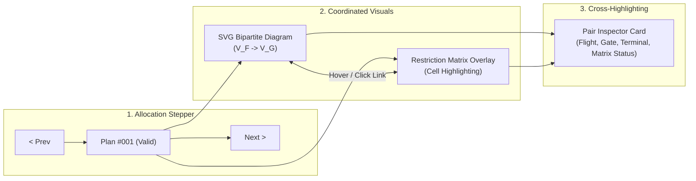

# Phase 19 Completion Report — Interactive Allocation Visualization

**Project**: GateWise — Intelligent Airport Gate Allocation Using Discrete Mathematics  
**Phase**: 19 — Interactive Allocation Visualization  
**Status**: Completed & Verified  
**Date**: November 15, 2026  

---

## 1. Executive Summary

Phase 19 delivers a rich, interactive visualization layer for GateWise's valid flight-to-gate allocations. 

Users can now visually explore:
1. **Bipartite Assignment Diagram ($G = (V_F, V_G, E)$)**: An interactive SVG representation with flights on the left, gates on the right, and dynamic cubic Bézier curves connecting assigned pairs for the selected allocation.
2. **Restriction Matrix Overlay**: An interactive $n \times n$ matrix grid clearly distinguishing Allowed ($0$), Forbidden ($1$), and currently **Assigned In Plan** cells, demonstrating why each assignment is valid or restricted.
3. **Allocation Stepper & Navigation**: Effortlessly step through generated allocations (`Prev`, `Next`, dropdown selector) with real-time visual updates to both the bipartite diagram and matrix overlay.
4. **Cross-Component Hover & Selection**: Hovering or clicking any flight, gate, connection edge, or matrix cell cross-highlights the corresponding entities across both the graph and the matrix, and renders an enriched **Pair Inspector Card**.
5. **Phase 17 Conflict Highlighting**: Visual indicators display clean valid connections (cyan/emerald glow) or highlight violations (pulsating red for forbidden cells, amber for duplicates, dashed borders for unassigned elements).

---

## 2. Modified & Created Components

| Component | Path | Description |
| :--- | :--- | :--- |
| **Bipartite Diagram** | `frontend/src/components/allocations/BipartiteDiagram.jsx` | Interactive SVG graph rendering flight nodes ($V_F$), gate nodes ($V_G$), and cubic Bézier edge linkages with glow filters and conflict cues. |
| **Matrix Overlay** | `frontend/src/components/allocations/AllocationMatrixOverlay.jsx` | Interactive $n \times n$ grid visualizing the restriction matrix with real-time allocation cell overlays. |
| **Results View** | `frontend/src/components/allocations/AllocationResultsView.jsx` | Enhanced with View Mode switcher (`Diagram`, `Table`, `Dual View`), allocation stepper, and Pair Inspector. |
| **Simulator Page** | `frontend/src/pages/AllocationSimulator.jsx` | Seamlessly mounts the interactive visualizer within the `/simulator` route. |

---

## 3. Visualization Features & Interaction Design

### 3.1 Bipartite Assignment Diagram (Section 2)
- **Node Geometry**: Left column anchors at $x = 250$, right column at $x = 570$.
- **Cubic Bézier Edges**:
  $$\text{Path} = M(x_1, y_1) \ C(x_1 + dx, y_1) \ (x_2 - dx, y_2) \ (x_2, y_2)$$
  where $dx = (x_2 - x_1) \times 0.45$.
- **Edge States**:
  - *Valid Link*: Glowing cyan/blue gradient (`#38bdf8` $\to$ `#3b82f6`).
  - *Active / Hovered Link*: Pure white-to-cyan glow with SVG drop shadow filter.
  - *Forbidden Link*: Dashed red stroke (`#ef4444`) with pulsating warning cues.
  - *Duplicate Link*: Amber stroke (`#f59e0b`).
  - *Unassigned*: Dashed yellow/slate borders on disconnected nodes.

### 3.2 Restriction Matrix Overlay (Section 4)
- **$n \times n$ Table Layout**: Flight row headers ($FL-001 \dots FL-00n$) and Gate column headers ($GT-001 \dots GT-00n$).
- **Cell States**:
  - *Allowed ($0$)*: Subtle slate background, indicates unassigned allowed option.
  - *Forbidden ($1$)*: Red-tinted background, indicates restricted flight-gate combination.
  - *Assigned Allowed (Plan)*: Glowing cyan border, checkmark icon, and `PLAN` tag.
  - *Assigned Forbidden (Violation)*: Glowing red border, warning icon, and `FORB` tag.

### 3.3 Coordinated Interactivity (Section 6)
- **Cross-Hover**: Hovering a flight, gate, or edge in the bipartite diagram instantly highlights the corresponding row, column, and cell in the matrix overlay (and vice-versa).
- **Pair Inspector Card**: Clicking or hovering any element pins the selection and opens a detailed breakdown:
  - Flight metadata: Airline, flight number, call sign.
  - Gate metadata: Terminal, gate type.
  - Matrix coordinates: Cell $[i, j]$, value ($0$ or $1$), and conflict diagnostic details.
  - "Clear Pin" action to unpin selection.

### 3.4 Discrete Math Model Integrity (Section 7)
- Includes a prominent caption in the diagram:  
  > *"Mathematical Bipartite Matching Diagram: Illustrates 1-to-1 relations between flight and gate vertex sets and matrix constraints, not physical terminal geography."*

---

## 4. Verification & Regression Status

### 4.1 Pytest Suite Execution
- **Command**: `cd backend; py -3 -m pytest tests/`
- **Result**: **123 / 123 passed in 2.31s** (0 regressions across Phases 11–18).

### 4.2 Frontend Production Build
- **Command**: `cd frontend; npm run build`
- **Result**: `✓ built in 757ms` with **0 errors**.

---

## 5. Architectural Boundary Adherence

- **Strictly Phase 19**: Did not implement Phase 20 (Performance benchmarking), Phase 21 (Dashboard integration), Phase 22 (Analytics), or Phase 26 (Report export).
- **Backend-Authoritative**: Allocation data, counts, and validation results are read directly from backend API responses without frontend duplication of math.
- **Dark Aviation Aesthetics**: Maintained GateWise's design system tokens (`gw-bg`, `gw-card`, `gw-cyan`, `gw-blue`, `gw-text`, `gw-text-secondary`).

---

Phase 19 is complete. We are stopped and awaiting your explicit approval before proceeding to **PHASE 20**.
